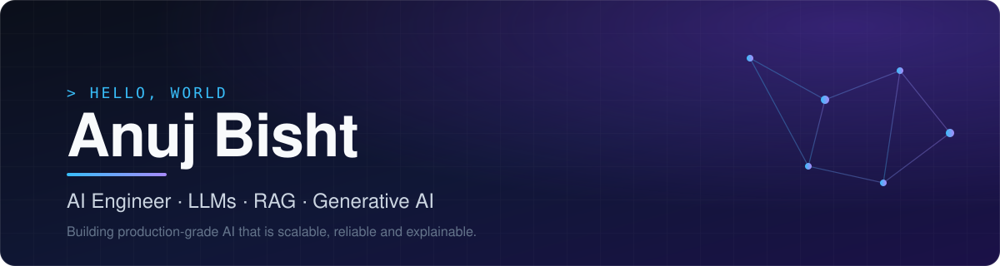

 

&nbsp;

&nbsp;

&nbsp;

  

 

## 👋 About Me

I'm an **AI Engineer** with 2+ years of experience building production-grade **LLM applications**, **Retrieval-Augmented Generation (RAG)** pipelines and **AI-driven evaluation systems** for enterprise clients.

I integrate large language models with Azure cloud services, speech-to-text and conversational AI avatars to automate complex workflows like interview assessment and resume screening, with a focus on solutions that are **scalable, reliable and explainable**.

<table>
  <tr>
    <td width="50%" valign="top">
      <b>💼 Currently</b> 
      Associate Software Engineer (AI) at <b>TestingXperts</b>  
      <b>🎓 Education</b> 
      B.Tech, Computer Science &amp; Engineering 
      First Class with Distinction (80.90%)
    </td>
    <td width="50%" valign="top">
      <b>📍 Based in</b> 
      Delhi, India  
      <b>🏅 Certified</b> 
      AWS Certified AI Practitioner
    </td>
  </tr>
</table>

 

## 🧰 Tech Stack

**AI / ML** 

  

**Languages** 

  

**Frameworks &amp; Tools** 

  

**Cloud &amp; Data** 

 

## 📈 GitHub Stats

&nbsp;

 

## 🤝 Let's Connect

I'm always open to conversations about **LLM applications, RAG systems and AI engineering**.
The best way to reach me is by [email](mailto:anujbisht09@gmail.com) or on [LinkedIn](https://www.linkedin.com/in/anujbisht/).

 

  Built with care · Updated October 2026

